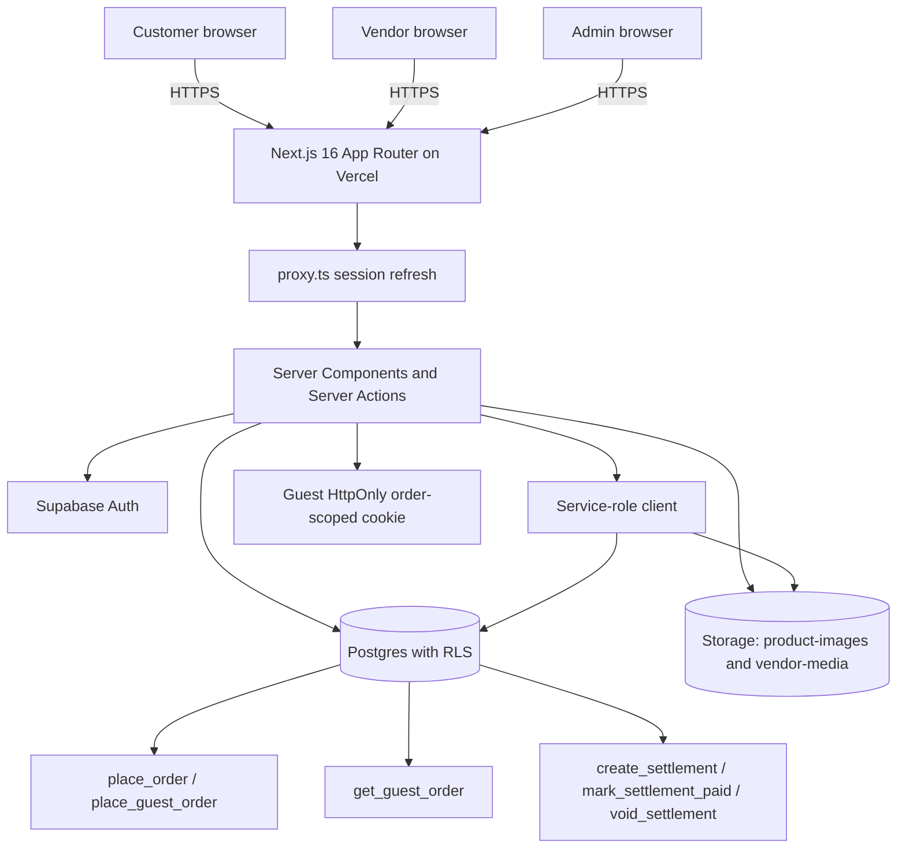

> **SUPERSEDED — 2026-11-20 (P0-08).** This file describes the pre-Phase-2 system (before migrations 28–32). Its claims about refunds, the order audit trail, delivery coverage, the admin order detail page, legal pages, SEO, tags, and settlements no longer describe the current system. Current state: `README.md` (features and counts), `docs/HOSTED_STATE.md` (hosted state — the single source), `docs/DECISIONS.md` (owner decisions). Kept as a dated record; its findings were not edited.

# Gifto Marketplace — Comprehensive Read-Only Pre-Launch Audit

**Date:** 8 November 2026
**Repository:** `C:\Users\bodyo\OneDrive\Desktop\gifto-marketplace`
**Branch/commit:** `main` @ `d64dae5` (`feat: ship managed onboarding and settlement lifecycle`)
**Audit type:** Static, read-only review of the repository, migrations, application code, tests, and documentation. No tests, builds, migrations, deployments, or remote database commands were executed during the audit.

**Working tree state (preserved):**
- Modified: `package.json`, `src/app/admin/page.tsx`, `src/app/shops/[slug]/page.tsx`, `src/app/shops/[slug]/[productSlug]/page.tsx`, `src/app/vendor/vendor-shell.tsx`, `src/components/product-image.tsx`, `src/components/shop-card.tsx`, `src/lib/catalog.ts`, `src/lib/guest-order.ts`, `src/lib/supabase/database.types.ts`.
- Untracked: three vendor-dashboard docs, `scripts/backfill-vendor-media.mjs`, admin/vendor support/analytics/settings routes, shop cover/logo components, support and vendor-settings libs/tests, migrations `20`–`24`, rollbacks `20`–`24`, and `supabase/tests/rls_vendor_dashboard_test.sql`.
- No commits, pushes, migrations, deployments, or code edits were made during the audit.

**Verification limitations:**
- Repository evidence is direct file/SQL inspection.
- Hosted Supabase schema and production behavior were **not** independently verified. `README.md:64` claims migrations 1–19 are hosted; `docs/STATUS_REPORT.md:7` claims 1–13; `docs/VENDOR_DASHBOARD_BACKEND_IMPLEMENTATION.md:5` says migrations 20–24 are local-only.
- No runtime tests, builds, `EXPLAIN`, load tests, browser E2E, or remote storage inspection were run.
- Security findings distinguish **confirmed policy/code** from **potential exploitability**.
- No secrets or environment values are reproduced; only variable names were observed.

**Severity:** P0 release-stopping · P1 must fix before public launch · P2 should fix before scale · P3 polish/debt.
**Verification:** Confirmed (repo) · Confirmed policy/exposure potential · Potential (config-dependent) · Not implemented (confirmed absence) · Historical claim · Not verified (remote).
**Classes:** A Done & verified · B Implemented but unverified · C Partially implemented · D Missing · E Bugs · F Production blockers · G Business blockers.

**Corrections applied to earlier audit notes:**
1. Product deletion **does** clean up images best-effort: `src/app/vendor/products/actions.ts:204-244`, cleanup at `:218-236`.
2. Customer order pages **do** degrade gracefully when vendor embeds return null after migration 20: `src/app/account/orders/page.tsx:95-101`; `src/app/account/orders/[id]/page.tsx:121-130`.
3. Admin support **can** update request status: `src/app/admin/support/actions.ts:18-65`; `src/app/admin/support/support-status-form.tsx`.
4. The footer `©` is a valid U+00A9; only `src/app/vendor/analytics/page.tsx:188` contains a literal U+FFFD. Earlier terminal output made other middle dots look corrupted.
5. `delivered → returned` exists as a **platform-admin-only database transition** (`supabase/migrations/00000000000005_orders.sql:154`), but there is no admin UI, refund record, or stock/accounting workflow. The database does not forbid returns entirely; the product does not operationalise them.

---

## Contents

1. [Executive Summary](#1-executive-summary)
2. [Overall Project Health](#2-overall-project-health)
3. [Architecture Diagram (Mermaid)](#3-architecture-diagram-mermaid)
4. [Business Operations](#4-business-operations)
5. [Customer Storefront](#5-customer-storefront)
6. [Vendor Dashboard](#6-vendor-dashboard)
7. [Admin Dashboard](#7-admin-dashboard)
8. [Backend and API](#8-backend-and-api)
9. [Database and RLS](#9-database-and-rls)
10. [Financial Integrity](#10-financial-integrity)
11. [Testing and QA](#11-testing-and-qa)
12. [Security](#12-security)
13. [Performance](#13-performance)
14. [Deployment and Production](#14-deployment-and-production)
15. [Launch Readiness](#15-launch-readiness)
16. [Critical Risks and Blockers](#16-critical-risks-and-blockers)
17. [Technical Debt and Missing Features](#17-technical-debt-and-missing-features)
18. [Prioritized Execution Roadmap](#18-prioritized-execution-roadmap)
19. [Top 10 Findings Ranked by Risk](#top-10-findings-ranked-by-risk)
20. [Top 5 Mandatory Pre-Launch Fixes](#top-5-mandatory-pre-launch-fixes)
21. [Features to Postpone](#features-to-postpone)
22. [Launch Recommendation](#launch-recommendation)

---

## 1. Executive Summary

**Verdict: NO-GO for public launch in the current working-tree state.**

The marketplace has a strong transactional core, but it is not operationally or financially complete, and the application code is ahead of the hosted database.

**What is strong:**
- Server-authoritative pricing, stock, commission, and totals; database row locks; idempotent checkout; guest token hashing; RLS and least-privilege grants; settlement void lifecycle; active-vendor hardening; pause controls; Tailwind CSS postbuild verification.
- Core COD checkout, vendor order transitions, admin oversight, and the settlement ledger are implemented with thoughtful database constraints.

**What blocks launch:**
- **P0:** Migrations 20–24 are untracked and unapplied while the working-tree code expects them. Deploying code first breaks settings/storefront; applying the database first changes vendor privacy and order-history behavior. There is no verified staging or rollback sequence.
- **P1:** No operational returns/refunds workflow; paid settlements block returns; settlement creation races with returns.
- **P1:** Guest orders are cookie-only for seven days; there is no email/SMS confirmation or recovery path.
- **P1:** Price changes are applied without explicit customer consent.
- **P1:** Public storage buckets expose unreleased media if object paths are known or listed.
- **P1:** No legal/consumer pages (terms, privacy, returns, contact); English-only.
- **P1/P2:** No CI/DB test automation, no monitoring, unbounded queries, silent 60-item truncation, and documentation drift.

**Bottom line:** The code is promising and the database design is above average, but the release and operations layer is not ready. A public launch now would create avoidable financial, legal, and support risk.

The register contains **1 P0** and **9 P1** findings; the remaining items are P2/P3 and are detailed in Sections 4–17.

---

## 2. Overall Project Health

| Area | Rating | Assessment |
|---|---|---|
| Architecture and code quality | B+ | Clear App Router structure, typed helpers, server actions, good comments; some hand-written types and duplicated query logic. |
| Database and RLS | B | Strong RLS/least privilege and settlement constraints; migrations 20–24 release hygiene and concurrency gaps. |
| Customer storefront | C+ | Core browse/cart/checkout works; guest recovery, price consent, truncation, SEO, and legal gaps. |
| Vendor dashboard | B- | Orders, products, inventory, finance, analytics, settings, support; settings/FAQ mismatch, unbounded queries, no commission history. |
| Admin dashboard | C+ | Vendor/status/commission/settlement/support controls; orders read-only; no returns/refunds; unbounded lists. |
| Financial integrity | C+ | Integer minor units, snapshotted rates, reversal trigger, void lifecycle; returns, payouts, and COD reconciliation incomplete. |
| Testing and QA | C | Nine tracked unit test files and eight tracked RLS suites; ninth suite untracked; no CI/DB automation/E2E in repo. |
| Security | B- | Good RLS/service-role discipline; public media, proxy-header trust, missing global headers/CAPTCHA. |
| Deployment | D | Dirty tree, untracked migrations, no staging evidence, no monitoring, conflicting hosted-state docs. |
| Documentation | C- | Useful docs but stale and conflicting status/test claims. |
| Business readiness | D | Returns, notifications, legal, payouts, COD reconciliation, Arabic, and vendor onboarding incomplete. |

**Overall:** Engineering foundations are roughly **7/10**; public-launch readiness is roughly **3/10**.

---

## 3. Architecture Diagram (Mermaid)

**Important architecture notes:**
- COD only; no card/payment provider.
- No transactional email/SMS provider; Supabase Auth handles account invite/confirmation only.
- Guest checkout uses a browser-generated token, SHA-256 hashed in Postgres, with the raw token in an HttpOnly cookie.
- Vendor and admin writes go through RLS-protected server actions; service-role is used for guest order creation/retrieval.
- The working tree expects migration 20–24 schema (vendor profile fields, `vendor-media`, `support_requests`, `is_accepting_orders`, analytics index), but those migrations are not in the hosted schema per the documentation.

---

## 4. Business Operations

**Launch model:** COD only; free delivery at launch; per-vendor commission; managed vendor onboarding; Egypt/Alexandria focus. These are recorded in `docs/DECISIONS.md` (D-01 `:24-35`, D-02 `:37-47`, D-05 `:50-61`, D-06 `:101-111`, D-08 `:143-150`). Returns policy (D-09 `:63-99`) and vendor subscriptions (D-07 `:113-119`) remain blocked.

| ID | Sev | Class / Verification | Evidence | Impact | Remediation | Dependencies |
|---|---|---|---|---|---|---|
| `OPS-001` | P1 | D/G · Confirmed absence | `src/lib/orders.ts:53-76` has no `returned` vendor transition; `src/app/vendor/orders/actions.ts:20-67`; `src/app/account/orders/[id]/page.tsx:48,205`; `src/app/admin/orders/page.tsx:36-41,73` is read-only; `00000000000005_orders.sql:154` allows `delivered → returned` only for platform admins; no refunds table or code; D-09 blocked. | Post-delivery returns cannot be processed through the product. No refund ledger, no admin return action, no COD cash-refund record, no stock/quarantine policy. Disputes require raw SQL. | Add return-request entity, admin/vendor approval, refund record, commission/settlement adjustment, stock policy, UI, and tests. | D-09 owner decision; settlement policy; migration. |
| `OPS-002` | P1 | D/G · Confirmed absence | No email/SMS integration; grep found only UI copy (`src/app/vendor/support/page.tsx:143`, `src/app/admin/support/page.tsx:63`); `.env.example` contains only Supabase and site variables. | No order confirmation, status-change, support, or payout notifications. Vendors can miss orders; customers cannot recover confirmations. | Add transactional email/SMS with an outbox, retries, templates, and preferences. | Provider, domain, environment variables. |
| `OPS-003` | P1 | D/G · Confirmed absence | No `terms`, `privacy`, `returns`, `contact`, or `help` routes; `src/components/site-footer.tsx:68-69` links only Shop/account surfaces; `src/app/layout.tsx:69` is English-only. | Egypt consumer-protection/legal exposure; weak trust; potential payment/provider onboarding blockers. | Add legal/consumer pages, footer links, and Arabic localization. | Legal review. |
| `OPS-004` | P2 | D · Confirmed absence | Settlements have only a free-text `note`; no payout reference, method, bank details, or proof; no COD remittance batch/reconciliation report. | Payout disputes and reconciliation are manual and unauditable. | Add payout reference/method/attachment and a COD batch reconciliation report. | Finance operations. |
| `OPS-005` | P2 | D · Confirmed absence | `src/app/admin/actions.ts:96-176` creates a vendor with name/email/commission; `setVendorStatus` is separate; migration 20 profile fields are optional. | A vendor can be activated without address, working hours, documents, or a quality checklist. | Add onboarding checklist, required fields, document uploads, and an approval gate. | Operations/legal. |
| `OPS-006` | P3 | D · Confirmed absence | Admin UI creates categories but has no product approval/hide workflow; products go live when the vendor is active. | Quality and legal risk from unreviewed listings. | Add moderation status and admin product/category controls. | Catalog migration. |
| `OPS-007` | P3 | D · Business decision | D-06 (`docs/DECISIONS.md:101-111`) keeps delivery free at launch. | Not a defect, but the fee model, vendor settlement of delivery cost, and customer expectations are undefined. | Define the fee model after launch data. | Owner decision. |

---

## 5. Customer Storefront

| ID | Sev | Class / Verification | Evidence | Impact | Remediation | Dependencies |
|---|---|---|---|---|---|---|
| `CHK-001` | P1 | E/G · Confirmed behavior | `src/lib/cart.ts:126-131` sends only product IDs and quantities; `src/app/checkout/checkout-form.tsx:87-106` and `:288-292` disclose only sold-out rejection; migration 22 `_create_order` reads database prices at `:182-207` and computes the subtotal at `:239-241` with no expected-price comparison. | A customer can be charged a higher price than displayed without explicit consent. Trust, COD-refusal, and consumer-protection risk. | Send expected unit prices/total; reject with a “price changed” error and require reconfirmation; update checkout/footer copy. | RPC/action/UI change. |
| `CHK-002` | P1 | D/G · Confirmed absence | `src/lib/guest-order.ts:16` sets a 7-day cookie; `src/app/orders/[id]/page.tsx:85-96` reads only the cookie; page copy at `:113-116` says the confirmation stays in the browser; no email/SMS; no reference/phone lookup. | Guests who lose the cookie cannot recover the order; no confirmation proof; support burden; vendors may receive unconfirmed COD orders. | Add email/SMS confirmation with reference plus tokenized lookup, resend, account claim, and server-side expiry. | `OPS-002` notification provider. |
| `CHK-003` | P2 | E · Confirmed behavior | `00000000000011_guest_checkout.sql:561-620` checks only the token hash; no expiry column; cookie max age is seven days. | A stolen/leaked guest token remains valid indefinitely server-side. | Add `guest_token_expires_at`, enforce it in `get_guest_order`, rotate/revoke. | Migration and order-page change. |
| `CHK-004` | P3 | E · Confirmed behavior | Checkout validation is manual and permissive; `src/lib/cart.ts:1-10` treats cart data as display-only and does not revalidate on page load. | Bad phone/governorate data and stale cart prices/stock cause failed deliveries and checkout surprises. | Normalize Egyptian phone numbers, constrain governorates, and revalidate the cart on checkout load. | Checkout UI/RPC. |
| `CAT-001` | P2 | E · Confirmed behavior | `src/lib/catalog.ts:161,170,213,222,287,308` applies `.limit(60)` for category, shop, and search loaders; `src/app/shops/[slug]/page.tsx:116-121` derives counts from returned rows. | Products beyond 60 are silently invisible; counts are misleading; search appears complete when it is not. | Add pagination/load-more, exact count queries, and “showing X of Y”. | Indexes and UI. |
| `SEO-001` | P3 | D · Confirmed absence | Product page metadata is static (`src/app/shops/[slug]/[productSlug]/page.tsx:9`); no `robots`/`sitemap` files; no JSON-LD. Root metadata exists at `src/app/layout.tsx:37-58`. | Weak product discoverability and sharing. | Add `generateMetadata`, sitemap, robots, and product JSON-LD. | None. |
| `ACC-001` | P2 | D · Confirmed absence | `src/app/account/page.tsx:73-101` is read-only; no profile edit, address book, or customer password-reset route. Only admin vendor invite/recovery exists (`src/app/admin/actions.ts:210`). | Customers cannot manage their own data or recover passwords without support. | Add account settings, address book, and forgot-password flow. | Auth/UI. |
| `ACC-002` | P3 | C · Confirmed behavior | `src/app/account/orders/[id]/page.tsx:48,205` shows cancellation only while the order is `placed`; `src/app/account/orders/actions.ts:16-38` calls `cancel_order`. | Customers cannot cancel after vendor confirmation and have no return request path. | Define cancellation policy and add a post-confirmation request flow. | `OPS-001`. |

**What works well:**
- Guest order pages are token-gated and `noindex`/`no-store`: `src/app/orders/[id]/page.tsx:14-19`; `next.config.ts:21-31`.
- Paused shops/products show clear notices: `src/app/shops/[slug]/page.tsx:96-104`; product page `:128-150`.
- Checkout is server-authoritative and idempotent: `src/app/checkout/actions.ts:22-23,63-72,164-196`.

---

## 6. Vendor Dashboard

| ID | Sev | Class / Verification | Evidence | Impact | Remediation | Dependencies |
|---|---|---|---|---|---|---|
| `VEN-001` | P2 | C · Confirmed mismatch | `src/app/vendor/settings/page.tsx:16-32` still lists address, working hours, and prep times as “not configurable”; query `:43-49` selects `cover_path` and `is_accepting_orders` but not `address_line`/`working_hours`/prep fields; update action `src/app/vendor/settings/actions.ts:174-187` writes only legacy fields; migration 20 adds the fields at `:25-34`; FAQ `src/lib/support-content.ts:161-163` is stale. | Migration 20’s profile fields are unused; vendors cannot set hours/address; help content contradicts the schema. | Expose fields with validation/actions and update the FAQ. | Migration 20; `vendor-settings.ts` validation. |
| `VEN-002` | P2 | C/D · Confirmed partial | Vendor support form exists (`src/app/vendor/support/page.tsx:32-37`; `src/app/vendor/support/actions.ts:68-93`; migration 23); admin can change status (`src/app/admin/support/actions.ts:18-65`); admin page says “No replies or notifications are sent” (`src/app/admin/support/page.tsx:62-63`); FAQ `src/lib/support-content.ts:182-184` says no backend exists. | Vendors receive no reply or notification; support is one-way; FAQ is wrong. | Add replies/notifications or integrate an external helpdesk; update FAQ. | `OPS-002`. |
| `VEN-003` | P2 | C · Confirmed inconsistency | Migration 21 `:30-40` allows active managers to upload branding; `src/app/vendor/settings/page.tsx:51` restricts editing to owner/admin; branding actions reject managers (`src/app/vendor/settings/actions.ts:410-412`). | Managers can write via API but not UI; orphaned media possible. | Align policy and UI; add orphan cleanup. | Storage policy decision. |
| `VEN-004` | P2 | E · Confirmed behavior | `src/app/vendor/overview/page.tsx:24-41` loads all suborders/products; `src/app/vendor/finance/page.tsx:63-81` loads all commission entries/settlements. | Pages slow or time out as history grows. | Paginate or use aggregate RPCs. | Indexes. |
| `VEN-005` | P3 | E · Confirmed behavior | `src/lib/vendor-analytics.ts:34-37` caps “all time” at 1,000 rows; implementation doc `:93` calls it a bounded sample. | “All time” metrics may mislead vendors. | Replace with a database-side aggregate RPC. | Migration. |
| `VEN-006` | P3 | E · Confirmed | `src/app/vendor/analytics/page.tsx:188` contains a literal U+FFFD in the date/bucket separator. | Visible mojibake. | Replace with `·` or `–`. | None. |
| `VEN-007` | P3 | D · Confirmed absence | Finance shows entries/settlements but no commission-rate history or payout method; cross-ref `ADM-001`/`OPS-004`. | Vendors cannot audit rate changes or payout destination. | Add rate history and payout profile. | Finance ops. |

**What works well:**
- Vendor order transitions are constrained and mirrored by the database: `src/lib/orders.ts:53-76`; `src/app/vendor/orders/actions.ts:20-67`.
- Pause control is authoritative in the order RPC: migration 22 `:13-17,233-236`.
- Product deletion cleans images best-effort: `src/app/vendor/products/actions.ts:218-236`.
- Analytics reconciliation and settings validation have unit tests.

---

## 7. Admin Dashboard

| ID | Sev | Class / Verification | Evidence | Impact | Remediation | Dependencies |
|---|---|---|---|---|---|---|
| `ADM-001` | P2 | D · Confirmed absence | `src/app/admin/actions.ts:64-89` updates `vendors.commission_rate`; no history table or trigger; vendor status history exists elsewhere. | Commission changes are unauditable; disputes are hard to resolve. | Add a commission-rate history table and admin view. | Migration. |
| `ADM-002` | P2 | C · Confirmed partial | `src/app/admin/support/page.tsx:31-37` limits the queue to 100; `:62-63` confirms no replies/notifications; status updates work via `src/app/admin/support/actions.ts:18-65`. | Older requests disappear; support remains one-way. | Add pagination, replies, and notifications. | `OPS-002`. |
| `ADM-003` | P3 | D · Confirmed absence | `src/app/admin/actions.ts:96-176` creates vendors with name/email/commission; activation is separate; migration 20 fields optional. | Vendors can go live without a complete profile. | Add activation checklist and required fields. | `OPS-005`. |
| `ADM-004` | P3 | D · Confirmed absence | Settlements store only a note; `mark_settlement_paid` records actor/time but no payout reference/proof. | Payout reconciliation and dispute evidence are weak. | Add payout reference/method/attachment. | `OPS-004`. |
| `ADM-005` | P3 | C · Confirmed implementation | Admin support status updates (`src/app/admin/support/actions.ts:18-65`), settlement create/paid/void actions (`src/app/admin/settlements/actions.ts`), and vendor status/commission controls exist. | Positive: operational controls exist. | Keep; add audit/history around them. | `ADM-001`. |
| `ADM-006` | P1 | D/G · Confirmed absence | `src/app/admin/orders/page.tsx:36-41` lists orders and `:73` labels the page read-only; no admin cancel/return/refund action. | Admins cannot resolve disputes or process returns. | Add admin order actions with audit and refund records. | `OPS-001`. |

---

## 8. Backend and API

| ID | Sev | Class / Verification | Evidence | Impact | Remediation | Dependencies |
|---|---|---|---|---|---|---|
| `API-001` | P2 | E · Confirmed code; exploitability potential | `src/lib/guest-order.ts:44-79` prefers `x-real-ip` and accepts any trimmed string up to 100 characters; `src/app/checkout/actions.ts:54-67` passes the result to the quota RPC; the code comment assumes a correctly configured edge proxy overwrites the header. | If the deployment passes client-supplied `x-real-ip`, an attacker can rotate buckets and bypass the 60/hour checkout quota. | Use a platform-trusted IP header, validate IP syntax, and add WAF/CAPTCHA. | Vercel header behavior verification. |
| `API-002` | P3 | E · Confirmed code; minor race | `00000000000023_vendor_support_requests.sql:52-81` counts recent requests then inserts without a lock. | Concurrent submissions can exceed five per 15 minutes. | Use an advisory lock or a dedicated rate-limit row/table. | Migration. |
| `API-003` | P3 | A/B · Confirmed implementation | Idempotency and quota: `src/app/checkout/actions.ts:22-23,63-72,164-196`; server-authoritative pricing/stock: migration 22 `:182-241`; guest token hashing: `src/lib/guest-order.ts:1-20`. | Strong core transaction design. | Preserve; add tests for price-change consent and header trust. | None. |
| `API-004` | P3 | D · Confirmed absence | No transactional notification/webhook integration; cross-ref `OPS-002`. | External systems cannot react to order events. | Add an outbox/event layer when notifications or integrations are introduced. | `OPS-002`. |

---

## 9. Database and RLS

| ID | Sev | Class / Verification | Evidence | Impact | Remediation | Dependencies |
|---|---|---|---|---|---|---|
| `DB-001` | P0 | F · Confirmed repo state; hosted application not verified | Git status shows migrations `20`–`24` and rollbacks untracked; `docs/VENDOR_DASHBOARD_BACKEND_IMPLEMENTATION.md:5` says nothing is hosted/committed; working-tree code selects `cover_path`, `is_accepting_orders`, `support_requests`, and `vendor-media`; `README.md:64` says hosted state is 1–19. | Deploying code before the database causes 500s; applying the database before code changes privacy/order-history behavior. Release is not reproducible. | Commit/review migrations and code, apply to staging first, back up, then deploy in lockstep with smoke tests and a rollback plan. | Owner approval; backup; staging. |
| `DB-002` | P2 | C · Confirmed policy; runtime behavior not verified | Migration 20 `:20` drops the broad vendor read policy; customer pages embed `vendor:vendors` at `src/app/account/orders/page.tsx:19` and `src/app/account/orders/[id]/page.tsx:40`; fallbacks at `:95-101` and `:121-130`. | Shop names/links disappear from customer order history after migration 20; no crash. | Read vendor names through a customer-safe view/RPC or snapshot `vendor_name` on `order_vendors`. | Migration 20. |
| `DB-003` | P3 | C · Confirmed SQL; exploitability potential | `public_vendors` view is defined without `security_barrier` (`00000000000020_vendor_profile_privacy.sql:137-152`; `00000000000022_vendor_pause_checkout.sql:19-35`). | Potential predicate leakage if future filters/leaky operators are added. | Add `security_barrier=true` or use a function/RPC. | Migration. |
| `DB-004` | P3 | C · Confirmed SQL | Rollback `20` restores the broad vendor read policy. | Rolling back re-exposes private vendor fields. | Make the rollback privacy-safe or document it as a break-glass action. | Migration policy. |
| `DB-005` | P3 | C · Confirmed | `src/lib/supabase/database.types.ts:1-27` is hand-written; implementation doc `:94` says regenerate after applying migrations. | Type drift can cause runtime/schema mismatches. | Generate types in CI and fail on diff. | Supabase CLI. |
| `DB-006` | P3 | C · Confirmed missing index | Search uses `%term%` ILIKE at `src/lib/catalog.ts:311`; no `pg_trgm`/`tsvector` index exists in migrations. | Full scans and slow search as catalog grows. | Add a trigram or full-text index and paginate. | Migration; query-plan validation. |
| `DB-007` | P3 | C · Confirmed debt | README `:437-439` notes Supabase default ACLs remain broad for future public tables. | New tables can be exposed if grants are forgotten. | Add a default-ACL migration and a table-creation checklist. | Migration. |
| `DB-008` | P3 | A · Confirmed implementation | Least privilege and RLS: `00000000000012_order_table_privileges.sql:13-27`; `00000000000014_managed_vendor_onboarding.sql:3-17`; `00000000000019_public_vendor_view_privileges.sql:8-9`; migration 20/21/23 policies. | Strong security baseline. | Preserve; extend tests to migrations 20–24. | None. |
| `DB-009` | P3 | C · Confirmed absence | No `returned_at`, quarantine/bin state, or return reason; D-09 `:63-99`. | Returns cannot be tracked accurately. | Add return metadata and stock policy. | `OPS-001`/D-09. |

---

## 10. Financial Integrity

| ID | Sev | Class / Verification | Evidence | Impact | Remediation | Dependencies |
|---|---|---|---|---|---|---|
| `FIN-001` | P1 | E · Confirmed SQL race; no concurrency test run | `00000000000018_settlement_void_lifecycle.sql:230-239` inserts settlement lines from `commission_entries` without locking the entries; `reverse_commission_on_return` at `:139-176` checks active lines; the partial unique index at `:101-103` does not prevent a stale-read race. | A commission reversed by a return can still be included in a concurrent settlement, overpaying the vendor and misstating platform revenue. | Lock commission entries in `create_settlement` in deterministic order, or revalidate after insert; add a concurrency test. | Migration; test harness. |
| `FIN-002` | P1 | E/G · Confirmed behavior | `00000000000018_settlement_void_lifecycle.sql:166-169` blocks reversal while any settlement line is active; `:352-353` rejects voiding a paid settlement; no release/adjustment RPC exists; no admin return UI. | Once a payout is recorded, a genuine post-payout return cannot be processed without raw SQL. Accounting and customer resolution deadlock. | Define clawback/adjustment policy; add release/adjustment RPC and negative settlement lines; or enforce returns-before-payout operationally. | Owner decision; migration. |
| `FIN-003` | P2 | E · Confirmed SQL | `mark_settlement_paid` (`:263-299`) locks the settlement and checks its status but does not recheck line statuses/amounts. | Future changes could pay a batch containing invalid lines. | Revalidate lines and total under lock. | Migration. |
| `FIN-004` | P2 | D/G · Confirmed absence | No refunds table/ledger; no COD remittance batch; settlements have only a note; cross-ref `OPS-001`/`OPS-004`. | Refunds and cash reconciliation are untracked. | Add refund records and COD batch reconciliation. | Finance ops. |
| `FIN-005` | P3 | C · Confirmed partial | The commission reversal trigger exists (`00000000000018_settlement_void_lifecycle.sql:139-176`) but no UI can reach it; cross-ref `OPS-001`. | The ledger supports reversals that operations cannot perform. | Add admin return/refund action. | `OPS-001`. |
| `FIN-006` | P3 | A · Confirmed implementation | Integer minor units, snapshotted rate/base, `commission_amount_matches`, one-open-per-vendor index, void audit, and double-pay prevention in migrations 6/16/17/18. | Strong ledger foundations. | Preserve; add rate history and payout proof. | `ADM-001`/`OPS-004`. |

---

## 11. Testing and QA

| ID | Sev | Class / Verification | Evidence | Impact | Remediation | Dependencies |
|---|---|---|---|---|---|---|
| `QA-001` | P2 | D · Confirmed absence | No `.github` directory or CI config; `package.json:7-14` has build/test/typecheck scripts; eight tracked RLS suites plus `storage_stub.sql`; `supabase/tests/rls_vendor_dashboard_test.sql` is untracked; README `:419` claims eight suites. | Regressions and migration issues are not caught automatically; the ninth suite can be lost. | Add GitHub Actions for lint/typecheck/unit and a disposable-Postgres migration/RLS job; track the ninth suite. | Repository hosting. |
| `QA-002` | P3 | C · Confirmed docs/repo | README `:417` claims 75 tests/9 files; implementation doc `:62` claims 99 tests/11 files; README `:434` says the browser E2E is a temporary harness outside the repo. | Verification state is ambiguous; no reproducible E2E. | Update docs and add a small Playwright smoke suite. | CI. |
| `QA-003` | P3 | C · Confirmed absence | No tracked tests for migrations 20–24; only the untracked `rls_vendor_dashboard_test.sql`. | New schema/policies are not protected in the repository. | Track and extend the suite; include rollback tests. | `QA-001`. |
| `QA-004` | P3 | A · Confirmed implementation | Nine tracked unit test files; eight tracked RLS suites; destructive-test guard exists. | Good baseline. | Preserve. | None. |
| `QA-005` | P3 | D · Confirmed absence | No load/performance tests; cross-ref `PERF-001`–`PERF-005`. | Unknown behavior at scale. | Add k6/artillery tests before marketing. | Staging. |

---

## 12. Security

| ID | Sev | Class / Verification | Evidence | Impact | Remediation | Dependencies |
|---|---|---|---|---|---|---|
| `SEC-001` | P1 | C · Confirmed policy; exposure potential | `00000000000009_product_image_upload.sql:9-27` creates a public `product-images` bucket with SELECT to `public`; `00000000000021_vendor_media.sql:14-28` does the same for `vendor-media`; product uploads do not require active product status (`00000000000009_product_image_upload.sql:31-43`); vendor-media uploads are active-manager-only but media remains public after suspension. | Anyone who knows or enumerates paths can read unreleased product images and vendor branding. | Make buckets private with signed URLs, or restrict SELECT to public/active products and vendors; add storage tests; run the media backfill. | Image URL code changes; migration. |
| `SEC-002` | P2 | E · Confirmed code; exploitability potential | `src/lib/guest-order.ts:44-79`; `src/app/checkout/actions.ts:54-67`. | Checkout quota bypass if `x-real-ip` is client-controlled. | Trust a platform-verified IP header, validate IP syntax, and add edge rate limiting/CAPTCHA. | Vercel configuration. |
| `SEC-003` | P2 | D · Confirmed absence | `next.config.ts:21-31` adds headers only for `/orders`; no CSP, HSTS, X-Frame-Options, or Permissions-Policy. | Weaker XSS/clickjacking hardening. | Add global security headers; start CSP in report-only mode. | Deployment. |
| `SEC-004` | P3 | E · Confirmed race | `00000000000023_vendor_support_requests.sql:52-81`. | Minor support-spam bypass. | Advisory lock or dedicated rate-limit table. | Migration. |
| `SEC-005` | P3 | C · Confirmed partial | Buckets limit size/MIME (5 MB; JPEG/PNG/WebP/AVIF); no dimension validation, re-encode, or virus scan. | Storage abuse and malformed images. | Validate dimensions server-side, re-encode, and add AV scanning if uploads become public-facing at scale. | Storage pipeline. |
| `SEC-006` | P3 | C · Potential | Only the IP quota protects guest checkout/support; no CAPTCHA. | Automated abuse/spam. | Add Turnstile/hCaptcha and WAF rules. | Deployment. |
| `SEC-007` | P3 | D · Confirmed absence | No Sentry/OpenTelemetry/uptime alerts; cross-ref `REL-004`. | Security and availability incidents are invisible. | Add error tracking, structured logs, and alerts. | Operations. |
| `SEC-008` | P3 | A · Confirmed implementation | RLS/least privilege (`00000000000012`, `14`, `19`, `20`, `23`); service-role only in server actions; guest token hashed; no secrets observed in reviewed files. | Strong baseline. | Preserve; add headers/monitoring. | None. |

---

## 13. Performance

| ID | Sev | Class / Verification | Evidence | Impact | Remediation | Dependencies |
|---|---|---|---|---|---|---|
| `PERF-001` | P2 | E · Confirmed behavior | `src/app/admin/page.tsx:23-46`; `src/app/admin/orders/page.tsx:36-41`; `src/app/vendor/overview/page.tsx:24-41`; `src/app/vendor/finance/page.tsx:63-81` load unbounded lists. | Slow pages/timeouts as data grows. | Paginate or use aggregate RPCs and add indexes. | Migration/UI. |
| `PERF-002` | P2 | E · Confirmed behavior | `src/lib/catalog.ts:161,213,287` caps results at 60; `:311` uses leading-wildcard ILIKE. | Silent truncation and full scans. | Pagination, exact counts, and trigram/FTS indexes. | `CAT-001`/`DB-006`. |
| `PERF-003` | P3 | E · Confirmed behavior | `src/lib/vendor-analytics.ts:34-37` caps all-time at 1,000 rows. | Misleading and incomplete analytics. | Aggregate RPC. | `VEN-005`. |
| `PERF-004` | P3 | E · Confirmed behavior | `src/components/product-image.tsx:67-72` sets `unoptimized`; images are raw public-storage URLs. | Larger payloads and slower mobile LCP. | Use Next image optimization with `remotePatterns` or an image CDN/thumbnails. | Storage/CDN. |
| `PERF-005` | P3 | C · Confirmed absence | No pagination/count UI for admin/vendor/catalog lists; no caching/load tests; app is fully dynamic (`next.config.ts:10-15`). | Unknown scale behavior. | Add pagination, targeted caching, and load tests. | Staging. |

---

## 14. Deployment and Production

| ID | Sev | Class / Verification | Evidence | Impact | Remediation | Dependencies |
|---|---|---|---|---|---|---|
| `REL-001` | P1 | F · Confirmed repo state; remote not verified | Migrations 20–24 are untracked/unapplied; working-tree code expects them; README `:64` says hosted 1–19; implementation doc `:5` says local-only. | Coordinated release is impossible without a staging/rollback plan. | Commit, review, apply to staging, back up, deploy code and DB in lockstep, smoke test, rehearse rollback. | `DB-001`; owner approval. |
| `REL-002` | P1 | F · Confirmed absence | No staging environment evidence; no rollback rehearsal evidence; docs conflict (`docs/STATUS_REPORT.md:5,7` vs `README.md:64`). | Production schema and rollback behavior are uncertain. | Create a staging Supabase/Vercel environment; run migrations 1–24 and the RLS suites; document rollback. | Infrastructure. |
| `REL-003` | P2 | F · Confirmed | Dirty working tree: 10 modified and 22 untracked files; no CI gate. | Unreviewed/unreproducible deployment. | Commit in logical PRs; require CI; tag releases. | `QA-001`. |
| `REL-004` | P2 | D · Confirmed absence | No monitoring/error tracking/uptime alerts. | Blind production incidents. | Add Sentry/OpenTelemetry, logs, uptime checks, and database alerts. | Operations. |
| `REL-005` | P3 | A · Confirmed implementation | `package.json:7-8` uses `next build --webpack` and a postbuild Tailwind CSS verification script; `.vercel/project.json` links `gifto-marketplace`. | Build has a useful guard. | Preserve; verify production deployment status. | None. |
| `REL-006` | P3 | C · Confirmed partial | `.env.example` documents required names; no startup validation; backup/PITR posture is undocumented (see `docs/LAUNCH_READINESS_PLAN_REVIEW.md:124`). | Misconfiguration and data-loss risk. | Add env validation and decide backup/PITR plan. | Operations. |

---

## 15. Launch Readiness

| Area | Status | Notes |
|---|---|---|
| Core COD checkout | Functional | Server-authoritative, idempotent; price-consent gap. |
| Catalog/search | Functional with gaps | 60-item truncation, no trigram index, static product metadata. |
| Guest orders | Partial | Cookie-only recovery; no email/SMS; no token expiry. |
| Vendor operations | Partial | Orders/products/inventory/finance work; settings/support/commission history incomplete. |
| Admin operations | Partial | Oversight/settlements/support status work; orders read-only; no returns/refunds. |
| Financial integrity | Partial | Strong ledger; settlement race, paid-return deadlock, no refund/COD reconciliation. |
| Security | Partial | Strong RLS; public media, header trust, missing global headers/CAPTCHA. |
| Legal/compliance | Not ready | No terms/privacy/returns/contact; English-only. |
| Testing/QA | Partial | Good unit/RLS baseline; no CI/DB automation/E2E in repo. |
| Deployment | Not ready | Untracked migrations, no staging evidence, no monitoring. |
| Documentation | Drift | Conflicting migration/test claims. |

**Launch verdict:** **NO-GO for public launch.** A limited, invite-only pilot is possible only with explicit risk acceptance and manual operations.

---

## 16. Critical Risks and Blockers

| Risk | Trigger | Impact | Mitigation |
|---|---|---|---|
| `DB-001` / `REL-001` migration/code mismatch | Deploying the working tree before applying migrations 20–24, or vice versa | 500s, broken settings/storefront, privacy/order-history regressions | Coordinated staged release with backup, smoke tests, and rollback rehearsal. |
| `OPS-001` returns/refunds gap | Customer requests a return or COD dispute | No product path; raw SQL; accounting/stock divergence | Returns MVP with admin action, refund ledger, and stock policy. |
| `FIN-002` paid-settlement return block | Return requested after payout | Cannot record return/commission reversal | Clawback/adjustment policy and RPC; or returns-before-payout rule. |
| `FIN-001` settlement race | Return and settlement creation overlap | Overpayment/misstated revenue | Lock commission entries and add a concurrency test. |
| `SEC-001` public storage | Draft product/branding upload | Unreleased media exposure | Private buckets/signed URLs or status-aware SELECT policies. |
| `CHK-001` price consent | Vendor changes price before checkout | Customer charged more than displayed | Expected-price comparison and reconfirmation flow. |
| `CHK-002` guest recovery | Guest loses cookie/switches device | No order access/confirmation | Email/SMS confirmation and tokenized lookup. |
| `OPS-002` no notifications | Order/status/support/payout events | Missed orders and support burden | Transactional email/SMS with outbox. |
| `OPS-003` no legal pages | Public launch | Consumer-protection/trust risk | Terms/privacy/returns/contact pages and footer links. |
| `REL-002` no staging/rollback | First production migration | Unknown schema/rollback behavior | Staging environment and rehearsal. |

---

## 17. Technical Debt and Missing Features

### A–G classification

**A — Done and verified (repository evidence):**
- Server-authoritative pricing/stock/commission (`00000000000022_vendor_pause_checkout.sql:182-241`).
- RLS and least privilege (`00000000000012`, `14`, `19`, `20`, `23`).
- Guest token hashing and idempotency (`src/lib/guest-order.ts:1-20`; `src/app/checkout/actions.ts:22-23,164-196`).
- Settlement void lifecycle, audit actors, one-open-per-vendor, double-pay prevention (`00000000000018_settlement_void_lifecycle.sql`).
- Active-vendor hardening and pause control.
- Tailwind postbuild CSS verification (`package.json:7-8`; `scripts/verify-tailwind-css.mjs`).
- Product deletion image cleanup (`src/app/vendor/products/actions.ts:218-236`).
- Admin support status updates (`src/app/admin/support/actions.ts:18-65`).
- Admin settlement actions (`src/app/admin/settlements/actions.ts`).
- Guest order `noindex`/`no-store` (`src/app/orders/[id]/page.tsx:14-19`; `next.config.ts:21-31`).

**B — Implemented but unverified:**
- Migrations 20–24 and rollbacks (local-only per `docs/VENDOR_DASHBOARD_BACKEND_IMPLEMENTATION.md:5`).
- Vendor settings fields (schema exists; UI/actions not wired).
- Vendor support backend (form/table/policies exist; replies/notifications absent).
- Analytics index and media backfill script.
- Hosted migration 1–19 claims (historical docs, not independently verified).

**C — Partially implemented:**
- Vendor settings/FAQ consistency.
- Support replies/notifications.
- Manager branding policy vs UI.
- Customer order-history vendor names after migration 20.
- Settlement/refund operations.
- Commission-rate audit/history.
- Pagination/search/counts.
- Security headers, monitoring, docs.
- Legal/compliance and localization.

**D — Missing:**
- Returns/refunds workflow and refund ledger.
- Transactional notifications.
- Legal/consumer pages.
- Customer profile/address management and password reset.
- Sitemap/robots/JSON-LD.
- CAPTCHA/WAF.
- CI/DB test automation and repo E2E.
- Staging environment and rollback rehearsal.
- Payout proof/COD reconciliation.
- Product moderation and vendor onboarding checklist.
- Arabic localization.
- `returned_at`/quarantine state.

**E — Bugs/defects:**
- Price changes without explicit consent (`CHK-001`).
- 60-item silent truncation (`CAT-001`).
- Guest token no server-side expiry (`CHK-003`).
- Weak phone/governorate validation and stale cart (`CHK-004`).
- Analytics U+FFFD (`VEN-006`).
- Unbounded queries (`PERF-001`).
- Search leading-wildcard ILIKE (`PERF-002`).
- Unoptimized images (`PERF-004`).
- Support rate-limit race (`API-002`).
- Settlement creation race (`FIN-001`).
- Paid-settlement return deadlock (`FIN-002`).
- `mark_settlement_paid` line recheck gap (`FIN-003`).

**F — Production blockers:**
- `DB-001` migrations 20–24 untracked/unapplied.
- `REL-001`/`REL-002` no staging/rollback/coordinated release.
- `REL-003` dirty tree/no CI gate.
- `SEC-001` public media exposure.
- `OPS-001` returns/refunds operational gap.
- `CHK-002` guest recovery/confirmation gap.
- `OPS-003` legal pages absent.

**G — Business blockers:**
- Returns policy D-09 unresolved.
- Vendor subscriptions D-07 unresolved.
- Payout/COD reconciliation and vendor payout profile.
- Vendor onboarding checklist/documents.
- Delivery fee model postponed.
- Arabic/localization.
- Legal/consumer compliance.

### Features that should be postponed
- Online card payments and payment-gateway integration.
- Delivery-fee engine and courier integration.
- Vendor subscriptions (D-07).
- Loyalty/referrals, vendor ads, advanced analytics warehouse.
- Automated returns portal (manual/admin-assisted MVP first).
- Multi-warehouse/quarantine inventory.
- Full Arabic localization (unless legally required for launch).

### Technical debt
- Hand-written `database.types.ts`.
- Untracked migrations/rollbacks/tests and dirty working tree.
- No CI/DB-test automation, no staging, no monitoring.
- No pagination/search indexes/image optimization.
- No commission-rate history or payout proof.
- No default-ACL migration for future tables.
- Documentation drift (`STATUS_REPORT` vs `README` vs implementation doc).

---

## 18. Prioritized Execution Roadmap

### Phase 0 — Release hygiene (1–2 days)
- Commit/review migrations 20–24, rollbacks, app code, and the ninth RLS suite.
- Run lint/typecheck/unit/build and the DB suites in a disposable database.
- Create a staging Supabase/Vercel environment; back up production.
- Update `README`/`STATUS_REPORT`/implementation doc to one source of truth.
- **Exit criteria:** clean commit, CI green, staging migrations 1–24 applied, smoke test passed.

### Phase 1 — Launch blockers (1–2 weeks)
- Coordinated migration/code release with rollback rehearsal (`DB-001`/`REL-001`/`REL-002`).
- Returns/refunds MVP: admin action, refund record, stock policy, settlement adjustment (`OPS-001`/`FIN-002`).
- Settlement race fix and concurrency test (`FIN-001`).
- Guest email/SMS confirmation, tokenized lookup, and token expiry (`CHK-002`/`CHK-003`/`OPS-002`).
- Price-change consent/reconfirmation (`CHK-001`).
- Private/signed media or status-aware storage policies (`SEC-001`).
- Legal/consumer pages and footer links (`OPS-003`).
- Monitoring/alerting (`REL-004`).
- **Exit criteria:** all P0/P1 closed; staged end-to-end COD/return/guest/refund smoke tests pass.

### Phase 2 — Operational completeness (2–4 weeks)
- Notifications for order/status/support/payout events.
- Vendor support replies or external helpdesk integration.
- Payout proof and COD remittance reconciliation (`OPS-004`).
- Commission-rate history (`ADM-001`).
- Vendor onboarding checklist/documents (`OPS-005`).
- Admin product/category moderation (`OPS-006`).
- Pagination, exact counts, and search index (`CAT-001`/`PERF-001`/`DB-006`).
- Global security headers and CAPTCHA/WAF (`SEC-003`/`SEC-006`).
- CI DB-test automation and repo E2E (`QA-001`/`QA-002`).
- **Exit criteria:** operations can run a full week without raw SQL; CI covers migrations/RLS.

### Phase 3 — Scale and UX (1–2 months)
- Arabic localization and RTL.
- Sitemap/robots/JSON-LD and product metadata.
- Image optimization/CDN.
- Analytics aggregate RPC.
- Customer profile/address/password reset.
- Delivery-fee model and courier integration.
- Load testing and performance budgets.
- **Exit criteria:** measured p95 targets met at expected launch traffic.

### Phase 4 — Post-launch
- Subscriptions (D-07), loyalty, vendor ads.
- Advanced analytics/warehouse.
- Automated returns portal and quarantine inventory.
- PITR/backup upgrade, WAF tuning, incident drills.

---

## Top 10 Findings Ranked by Risk

1. `DB-001` — Migrations 20–24 untracked/unapplied while working-tree code expects them (P0).
2. `OPS-001` — No operational returns/refunds workflow; admin orders read-only.
3. `FIN-002` — Paid settlements permanently block returns; no adjustment path.
4. `FIN-001` — Settlement creation races with commission reversal on returns.
5. `SEC-001` — Public storage buckets expose unreleased media if paths are known/listed.
6. `CHK-002` — Guest orders are cookie-only; no confirmation/recovery/notifications.
7. `CHK-001` — Price changes applied without explicit customer consent.
8. `OPS-003` — No legal/consumer pages; English-only.
9. `REL-002` — No staging/rollback verification; hosted-state docs conflict.
10. `QA-001` — No CI/DB-test automation; ninth RLS suite untracked.

---

## Top 5 Mandatory Pre-Launch Fixes

1. **Release sequencing:** commit/review migrations 20–24 and app code; apply to staging; back up; deploy in lockstep; rehearse rollback (`DB-001`/`REL-001`/`REL-002`).
2. **Returns/refunds and settlement integrity:** admin return action, refund ledger, paid-settlement adjustment policy, settlement-race fix (`OPS-001`/`FIN-001`/`FIN-002`).
3. **Guest confirmation/recovery:** email/SMS confirmation, tokenized lookup, resend, and server-side token expiry (`CHK-002`/`CHK-003`/`OPS-002`).
4. **Price-change consent:** expected-price comparison and explicit reconfirmation (`CHK-001`).
5. **Security and compliance gate:** private/signed media plus legal/consumer pages and footer links (`SEC-001`/`OPS-003`).

---

## Features to Postpone

- Online card payments and gateway integration.
- Delivery-fee engine and courier integration.
- Vendor subscriptions (D-07).
- Loyalty/referrals, vendor ads, advanced analytics warehouse.
- Automated returns portal (manual/admin-assisted MVP first).
- Multi-warehouse/quarantine inventory.
- Full Arabic localization unless legally required for launch.

---

## Launch Recommendation

**NO-GO for public launch.**

A **limited, invite-only pilot** is defensible only if all of the following conditions are met and the residual risks are explicitly accepted by the owner:

1. Migrations 20–24 are committed, reviewed, applied to staging and production with a verified backup, and the app is deployed in lockstep.
2. A returns/refunds runbook plus admin action exists; paid-settlement returns have an approved adjustment/clawback policy.
3. Guest orders receive an email/SMS confirmation with a reference and a recoverable lookup path; guest tokens expire server-side.
4. Checkout rejects or reconfirms price changes instead of silently charging the new price.
5. Public media is private/signed or restricted by product/vendor status.
6. Terms, privacy, returns, and contact pages exist and are linked in the footer.
7. Monitoring, error tracking, and alerts are live.
8. CI runs lint/typecheck/unit plus migrations/RLS suites on every change.

If these conditions cannot be met, launch as a **manual-operations pilot** with a small vendor set, explicit customer communication, and daily reconciliation — not as a public marketplace launch.

---

**Audit conclusion:** Gifto has a solid transactional and database foundation. The remaining work is primarily release engineering, financial operations, guest recovery, compliance, and operational tooling. Those are solvable, but they are launch blockers, not polish.

No files, commits, migrations, deployments, or code changes were made during the audit. The existing working tree was preserved.
