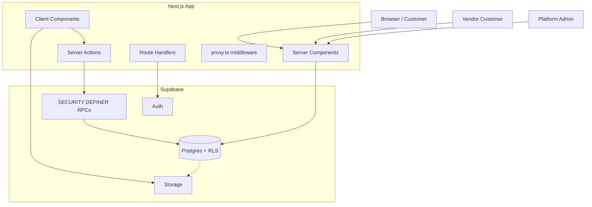
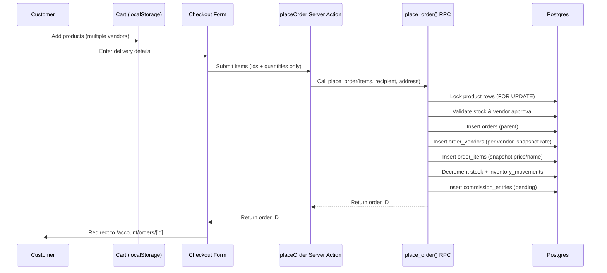

# Gifto Marketplace — Architecture and Flows

**Audit date:** 2026-10-19  
**Repository:** `C:\Users\bodyo\OneDrive\Desktop\gifto-marketplace`  
**Confidence level:** High — all diagrams reflect observed implementation.

---

## Technology Stack

| Layer | Technology | Version | Role |
|-------|-----------|---------|------|
| Framework | Next.js App Router | 16.4.2 | Server Components, Server Actions, Route Handlers, Proxy middleware |
| Frontend | React | 19.3.0 | UI components, client-side cart state |
| Styling | Tailwind CSS | v4 | Utility-first CSS, dark mode |

---

## Application Structure

```
src/
├── app/
│   ├── layout.tsx              # Root layout (dynamic, auth-aware)
│   ├── page.tsx                # Homepage (catalog rails + shops)
│   ├── proxy.ts                # Next.js proxy middleware (auth cookie refresh, route guards)
│   ├── auth/callback/route.ts  # Supabase auth callback handler
│   ├── (auth)/                 # Auth route group
│   │   ├── layout.tsx
│   │   ├── login/page.tsx
│   │   └── signup/page.tsx
│   ├── account/                # Customer account
│   │   ├── page.tsx            # Profile + vendor applications
│   │   ├── actions.ts          # applyAsVendor server action
│   │   ├── onboarding-form.tsx # Vendor application form
│   │   └── orders/             # Order history + detail + cancel
│   ├── cart/                   # Client-side cart
│   │   ├── page.tsx
│   │   └── cart-view.tsx
│   ├── checkout/               # COD checkout
│   │   ├── actions.ts          # placeOrder server action
│   │   └── checkout-form.tsx
│   ├── categories/             # Category browsing
│   │   ├── page.tsx
│   │   └── [slug]/page.tsx
│   ├── vendor/                 # Vendor back office
│   │   ├── products/           # Product CRUD, images, inventory
│   │   └── orders/             # Suborder fulfillment queue
│   └── admin/                  # Platform administration
│       ├── page.tsx            # Vendor approval, commission, categories
│       ├── actions.ts          # setVendorStatus, setCommissionRate, createCategory
│       ├── orders/             # Read-only cross-shop order oversight
│       ├── vendor-controls.tsx # Vendor status + commission UI
│       └── category-form.tsx   # Category creation form
├── components/
│   ├── cart-provider.tsx       # localStorage cart context (useSyncExternalStore)
│   ├── product-card.tsx, shop-card.tsx, category-tile.tsx
│   ├── auth-form.tsx, mobile-nav.tsx, search-form.tsx
│   ├── site-header.tsx, site-footer.tsx, sign-out-button.tsx
│   └── ui/section.tsx          # Container, EmptyState, SectionHeading, etc.
├── lib/
│   ├── auth.ts                 # requireUser, requirePlatformAdmin
│   ├── vendor.ts               # requireVendorRole (vendor session resolution)
│   ├── cart.ts                 # CartItem type, addToCart, setQuantity, etc.
│   ├── cart-store.ts           # useSyncExternalStore cart store
│   ├── catalog.ts              # Server-side catalog reads (loadCategories, loadProducts, searchProducts, etc.)
│   ├── money.ts                # Integer piastres: formatEgp, parseEgpToMinor, minorToEgpInput
│   ├── orders.ts               # Order status labels, styles, help text, vendor next statuses
│   ├── slugify.ts              # Slug generation (mirrors DB slugify())
│   └── supabase/
│       ├── client.ts           # Browser Supabase client (anon key)
│       ├── server.ts           # Server Supabase client (anon key, cookie-scoped)

---

## Component and Module Responsibilities

| Module | Responsibility | Trust boundary |
|--------|---------------|----------------|
| `proxy.ts` | Auth cookie refresh, route guards for /account, /admin, /vendor, /checkout | Convenience only — not a security boundary |
| `auth.ts` | Session verification (`requireUser`, `requirePlatformAdmin`) | Security boundary — identity from Supabase only |
| `vendor.ts` | Vendor session resolution, membership-based access | Security boundary — vendor ID from memberships, not client input |
| `cart.ts` | Client cart logic (merge, clamp, totals) | Never trusted — display state only |
| `cart-store.ts` | Cart persistence via localStorage + useSyncExternalStore | Never trusted |
| `catalog.ts` | Server-side catalog reads via Supabase anon key + RLS | Trusted (server-side) |
| `checkout/actions.ts` | Order placement via `place_order` RPC | Security boundary — prices from DB, not client |
| `money.ts` | Integer piastre formatting/parsing | Trusted (pure functions) |

---

## Frontend/Backend Communication

1. **Server Components → Supabase server client → Postgres:** All reads (catalog, orders, profile) go through Server Components using the anon key. RLS enforces row-level access.

2. **Server Actions → Supabase RPC:** All writes (place_order, cancel_order, apply_as_vendor, adjust_product_stock, setVendorStatus, etc.) go through Server Actions calling SECURITY DEFINER RPCs in the database.

3. **Route Handlers → Supabase server client:** Auth callback (`/auth/callback`) exchanges codes for sessions.

4. **Client components → Server Actions:** Form submissions (cart updates, checkout, product forms) use React 19 `useActionState` with Server Actions.

5. **Browser → Supabase Auth directly:** Login/signup via Supabase Auth client in browser components.

---

## Data Flow

### Read flow (public catalog)
```
Browser → Server Component (page.tsx) → catalog.ts → Supabase server client
                                          → Postgres (RLS: public reads active vendors/products)
                                          → Server Component renders HTML
```

---

## Authentication and Authorization

### Authentication
- **Provider:** Supabase Auth (email/password, magic links)
- **Session management:** Cookies via `@supabase/ssr` (`createBrowserClient`, `createServerClient`)
- **Proxy middleware:** `src/proxy.ts` refreshes auth cookies on every request and redirects unauthenticated users from protected prefixes (`/account`, `/admin`, `/vendor`, `/checkout`)

### Authorization layers
1. **Route-level:** `proxy.ts` redirects unauthenticated users (convenience only)
2. **Page-level:** `requireUser()`, `requirePlatformAdmin()`, `requireVendorRole()` verify session server-side
3. **Database-level:** RLS policies enforce row- and column-level access (the real security boundary)
4. **Function-level:** SECURITY DEFINER RPCs with pinned `search_path` and restricted EXECUTE

### Role model
| Role | Scope | How assigned |
|------|-------|--------------|

---

## Database Entities and Relationships

### Core entities

```
profiles (1) ←→ (many) vendor_members (many) ←→ (1) vendors
profiles (1) ←→ (many) orders
vendors (1) ←→ (many) products
vendors (1) ←→ (many) order_vendors
vendors (1) ←→ (many) commission_entries
vendors (1) ←→ (many) settlements
categories (1) ←→ (many) products
products (1) ←→ (many) product_images
products (1) ←→ (many) inventory_movements
products (1) ←→ (many) order_items
orders (1) ←→ (many) order_vendors
orders (1) ←→ (many) order_items (via order_vendors)
order_vendors (1) ←→ (many) order_items
order_vendors (1) ←→ (1) commission_entries
commission_entries (1) ←→ (many) settlement_lines
settlements (1) ←→ (many) settlement_lines
```

### Key constraints

| Constraint | Table | Purpose |
|------------|-------|---------|
| `total_minor = subtotal_minor + delivery_fee_minor` | orders | Order total integrity |
| `payment_method = 'cod'` | orders | COD-only enforcement |
| `currency = 'EGP'` | orders, products, commission_entries, settlements | Currency consistency |
| `price_minor >= 0` | products | Non-negative prices |
| `stock >= 0` | products | Non-negative stock |
| `amount_minor = round(base_minor * rate)` | commission_entries | Commission amount integrity |
| `(status = 'reversed') = (reversed_at is not null)` | commission_entries | Reversal state consistency |
| `unique(vendor_id, profile_id)` | vendor_members | One membership per user per vendor |
| `unique(vendor_id, slug)` | products | Unique product slug per vendor |
| `unique(slug)` | categories | Unique category slug |

---

## Mermaid Diagrams

### System Architecture



### Multi-Vendor Order Flow



### Vendor Suborder State Machine

```mermaid
stateDiagram-v2
    [*] --> placed
    placed --> confirmed : Vendor confirms
    placed --> cancelled : Customer cancels (before confirm)
    confirmed --> shipped : Vendor ships
    confirmed --> cancelled : Vendor cancels
    shipped --> delivered : Vendor delivers
    delivered --> returned : Platform admin returns
    
    note right of placed: Parent status derived:
    - confirmed: any suborder confirmed
    - delivered: ALL suborders delivered
    - cancelled: ALL suborders cancelled
```

### Commission Flow

```mermaid
sequenceDiagram
    participant Vendor as Vendor suborder
    participant RPC as record_commission_on_delivery trigger
    participant CE as commission_entries

---

## Customer, Vendor, and Admin Workflows

### Customer workflow
1. Browse homepage → view categories, shops, new arrivals, budget bands
2. Search/filter products → view product detail → add to cart (localStorage)
3. View cart (grouped by vendor) → proceed to checkout
4. Enter delivery details → place order (COD) → `place_order` RPC creates parent order + suborders
5. Redirect to order confirmation → view order history → track suborder statuses
6. Cancel order (only while `placed`) → stock restocked

### Vendor workflow
1. Sign up → auto-provisioned profile → apply as vendor (`apply_as_vendor` RPC)
2. Platform admin approves vendor (status → active)
3. Vendor creates products (draft or active) → uploads images (Storage)
4. Vendor manages inventory (`adjust_product_stock` RPC)
5. Vendor receives suborders (RLS-scoped to own vendor)
6. Vendor confirms/ships/delivers suborders (trigger-enforced transitions)
7. Vendor views commission entries (read-only via RLS)

### Admin workflow
1. Login → platform admin verification (`requirePlatformAdmin`)
2. View vendor applications (pending status) → approve/suspend/reject
3. Configure commission rates per vendor
4. Create categories
5. View all orders (read-only cross-shop oversight with per-suborder commission)
6. Create settlements (manual batch) → mark settlements paid

---

## Order and Inventory State Transitions

### Order status transitions (enforced by `assert_order_vendor_transition` trigger)

| From → To | Authorized role | Effect |
|-----------|----------------|--------|
| placed → confirmed | Vendor manager/owner, platform admin | Stock already decremented at placement |
| placed → cancelled | Order owner, platform admin | Stock restocked, `inventory_movements` row |
| confirmed → shipped | Vendor manager/owner, platform admin | None |
| confirmed → cancelled | Vendor manager/owner, platform admin | Stock restocked |
| shipped → delivered | Vendor manager/owner, platform admin | Commission becomes earned |
| delivered → returned | Platform admin only | Commission reversed (if unsettled) |

### Parent order status (derived)

---

## External Service Integrations

| Integration | Status | Implementation | Notes |
|-------------|--------|---------------|-------|
| Supabase Auth | DONE | `@supabase/ssr`, `/(auth)/` routes | Email/password, magic links |
| Supabase Postgres + RLS | DONE | 9 migrations, 7 RLS test suites | Row-level security is the authorization boundary |
| Supabase Storage | DONE | Migration 9 bucket, image upload actions | Public read, manager-scoped write by vendor folder |
| Email/SMS notifications | NOT IMPLEMENTED | — | No provider integrated |
| Payment gateway | NOT IMPLEMENTED | — | COD only (`payment_method = 'cod'` check constraint) |
| Carrier/shipping API | NOT IMPLEMENTED | — | Shops self-deliver |
- `placed`: All suborders `placed`
- `confirmed`: At least one suborder `confirmed` or later, none `delivered`
- `delivered`: All suborders `delivered`
- `cancelled`: All suborders `cancelled`

### Inventory movements
| Reason | Trigger | Delta sign |
|--------|---------|------------|
| `order_placed` | `place_order` | Negative (decrement) |
| `order_cancelled` | `cancel_order` | Positive (restock) |
| `manual_adjustment` | `adjust_product_stock` | Positive or negative |
    participant S as settlements
    
    Vendor->>RPC: status → delivered
    RPC->>CE: Insert earned entry (rate × subtotal)
    CE-->>Vendor: Commission earned
    
    Admin->>S: create_settlement(vendor_id)
    S->>CE: Collect earned, unsettled entries
    S-->>Admin: Return settlement ID
    
    Admin->>S: mark_settlement_paid(settlement_id)
    S-->>Admin: Record payout
    
    note over CE: Append-only ledger. CHECK amount = round(base × rate).
    Reversed on return before settlement.
```
| Customer | Own profile, own orders, cart | Auto-provisioned on signup (`handle_new_user` trigger) |
| Vendor owner | Own vendor: products, orders, inventory, images | `apply_as_vendor()` RPC creates owner membership |
| Vendor manager | Own vendor: products, orders (write), inventory | Owner or platform admin adds membership |
| Vendor staff | Own vendor: read-only | Owner or platform admin adds membership |
| Platform admin | All vendors, all orders, commission, categories | `is_platform_admin = true` on profile (guarded by trigger) |

### Write flow (checkout)
```
Browser → checkout-form.tsx → placeOrder Server Action
                              → Supabase server client → place_order() RPC
                              → Postgres (row locks, stock check, decrement, insert orders/suborders/items)
                              → Return order ID → Redirect to /account/orders/[id]
```

### Write flow (vendor product creation)
```
Browser → product-form.tsx → saveProduct Server Action
                             → Supabase server client → INSERT products (RLS: vendor owns product)
                             → Postgres → Return product ID → Redirect to edit page
```
│       ├── service.ts          # Service-role client (bypasses RLS, bootstrapping only)
│       └── database.types.ts   # Hand-written TypeScript DB types
```
| Language | TypeScript | 5.x (strict) | Type safety across client/server boundary |
| Backend | Supabase (Auth, Postgres, RLS, Storage) | — | Database, authentication, authorization, file storage |
| Testing | Vitest | 4.1.12 | Unit tests (Node environment) |
| Linting | ESLint | 9 | Code quality |
| Package manager | npm | — | Dependency management |