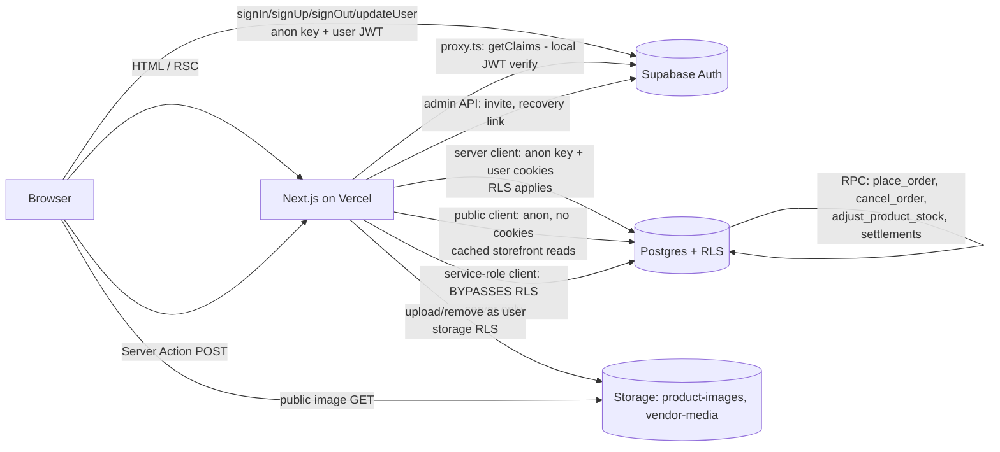
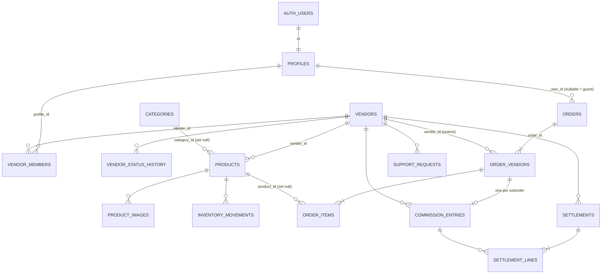

> **HISTORICAL — 2026-11-20 (P0-08).** Dated snapshot of a past verification (see the date in the file). Its numbers and hosted-state claims were true when written and are not current. Current state: `README.md`, `docs/HOSTED_STATE.md` (single hosted-state table), `docs/DECISIONS.md`. Kept as a record; its findings were not edited.

# Gifto — Architecture (as implemented today)

Review date: 2026-11-09. Read-only review: nothing outside `docs/review/` was modified.
Evidence style: `path:line` for code, `migration:line` for SQL. Items marked **(assumption)** could not be proven from the repo and say how to verify.

> Note on the working tree: migrations 20–24, the vendor Analytics / Settings / Support pages, and the Admin Support page are **untracked** (not committed). README says only migrations 1–19 are verified on the hosted project (`README.md`, "Database / Migrations").

---

## 1. Stack and versions

| Item | Value | Evidence |
|---|---|---|
| Framework | Next.js **16.4.2**, App Router (`src/app`), webpack build (`next build --webpack`) | `package.json` |
| React | 19.3.0 | `package.json` |
| Language | TypeScript 5, `strict: true`, path alias `@/* → src/*` | `tsconfig.json` |
| Styling | Tailwind CSS v4 (`@tailwindcss/postcss`) | `package.json`, `postcss.config.mjs` |
| Backend | Supabase (Postgres + Auth + Storage + RLS) via `@supabase/ssr` 0.12.x and `@supabase/supabase-js` 2.118 | `package.json` |
| Tests | Vitest 4 (16 unit-test files), 9 SQL/RLS suites in `supabase/tests/` | `vitest.config.ts`, `supabase/tests/` |
| Lint | ESLint 9 + `eslint-config-next` | `eslint.config.mjs` |
| Package manager | npm (`package-lock.json`) | repo root |
| Node | Local dev **v24.15.0**, npm 11.12.1. No `engines` field and no `.nvmrc`, so the production Node version is unpinned **(assumption — verify in Vercel project settings)** | shell, `package.json` |
| Hosting | Vercel project is linked locally (`.vercel/project.json` exists, git-ignored). No `vercel.json`. | `.gitignore:44` |
| CI | **None** (no `.github/` directory) | `Test-Path .github` → False |
| Other deps | Only `server-only`. No payment, email, SMS, map, analytics, or error-tracking SDK. | `package.json` |

Next config (`next.config.ts`): Server Action body limit 30 MB; `cacheComponents: false`; `/orders/:path*` gets `Referrer-Policy: no-referrer`, `Cache-Control: private, no-store`, `X-Robots-Tag: noindex`. **No other security headers are configured** (no CSP, HSTS, X-Frame-Options, Permissions-Policy). Image optimization settings (`images.remotePatterns`) are present only in the working tree.

## 2. Folder map

```
gifto-marketplace/
├─ src/
│  ├─ proxy.ts                 Next 16 "proxy" (middleware): refreshes Supabase session, redirects anonymous users from /account /admin /vendor
│  ├─ app/                     App Router: pages, layouts, loading/error boundaries, Server Actions (actions.ts), 1 route handler
│  │  ├─ (auth)/               login, signup (thin wrappers around components/auth-form)
│  │  ├─ auth/                 accept-invite (vendor/owner invite), callback (code exchange)
│  │  ├─ account/              customer account + order history + cancel
│  │  ├─ admin/                platform admin: vendors, categories, orders, settlements, support
│  │  ├─ vendor/               shop dashboard: overview, orders, products, inventory, finance, analytics, settings, support
│  │  ├─ shops/ categories/ search/ cart/ checkout/ orders/   public storefront + guest order confirmation
│  ├─ components/              UI building blocks (header/footer, product & shop cards, images, cart provider)
│  └─ lib/                     domain logic + Supabase clients (auth.ts, vendor.ts, catalog*.ts, finance.ts, orders.ts, cart*.ts, money.ts, guest-order.ts, ...)
│     └─ supabase/             client.ts (browser), server.ts (cookie/session), service.ts (service-role, server-only), public.ts (anon, cookie-less), database.types.ts
├─ supabase/
│  ├─ migrations/              24 versioned SQL migrations (schema, RLS, RPCs, triggers, storage policies)
│  ├─ rollbacks/               rollback scripts for migrations 14–18, 20–24
│  ├─ tests/                   9 SQL suites (RLS / money / state machine) + storage stub
│  ├─ seed.sql, config.toml    local Supabase config (not hosted settings)
├─ scripts/                    seed-demo.mjs, cleanup-demo.mjs, demo-passwords.mjs, backfill-vendor-media.mjs, verify-tailwind-css.mjs
├─ docs/                       existing planning/audit docs (+ docs/review/ = this review)
└─ public/                     og-image.png + 5 default create-next-app SVGs (unused template leftovers)
```

## 3. Routes and pages

Legend: **S** server component, **C** client component (`"use client"`), **A** Server Actions file, **R** route handler. "Guard" = server-side check inside the page/action.

### Storefront (public, no login)
| Route | Type | Notes |
|---|---|---|
| `/` | S | home rails: categories, new arrivals, budget bands, shops |
| `/categories`, `/categories/[slug]` | S (+loading) | |
| `/shops`, `/shops/[slug]`, `/shops/[slug]/[productSlug]` | S (+loading) | product detail |
| `/search` | S (+loading) | text/price/category search |
| `/cart` | S wrapper + C `cart-view` | cart lives in browser localStorage (`lib/cart-store.ts`) |
| `/checkout` | S + C `checkout-form` + A `actions.ts` | guest **and** signed-in; COD only; uses service-role RPC for guests |
| `/orders/[id]` | S (`force-dynamic`) | guest order confirmation, token-gated via HttpOnly cookie; service-role RPC `get_guest_order` |

### Customer account (guard: `requireUser`, plus proxy redirect)
`/account` (S; redirects admins → `/admin`, active vendors → `/vendor/overview`), `/account/orders` (S), `/account/orders/[id]` (S + C cancel button), A `account/orders/actions.ts` (`cancelOrder`).

### Vendor dashboard (guard: `requireVendorRole` in layout **and** every page/action)
`/vendor` (redirect), `/vendor/overview`, `/vendor/orders` (+A, C suborder actions), `/vendor/products` (+A), `/vendor/products/new`, `/vendor/products/[id]` (+images A, C panel), `/vendor/products/[id]/inventory` (+A, C form), `/vendor/inventory`, `/vendor/finance`, `/vendor/analytics`*, `/vendor/settings`* (+A, C forms/uploads), `/vendor/support`* (+A, C forms). `*` = untracked in git today. Shell `vendor-shell.tsx` is C.

### Admin dashboard (guard: `requirePlatformAdmin`, which also re-confirms the session with the Auth server)
`/admin` (vendors, categories, attention orders; A `admin/actions.ts`: `setVendorStatus`, `setCommissionRate`, `createVendor`, `createCategory`), `/admin/orders`, `/admin/settlements`, `/admin/settlements/[id]` (+A: create / mark paid / void), `/admin/support`* (+A).

### Auth
`/login`, `/signup` (S pages → C `components/auth-form.tsx`, **browser** Supabase Auth calls), `/auth/accept-invite` (S + C form: sets password for invited vendor owners), `/auth/callback` (**R** `route.ts`: exchanges `code`, same-site `next` only).

### API / route handlers
Only one: `GET /auth/callback`. There is no REST API; all mutations are Server Actions or Supabase RPC/PostgREST calls. There is **no payment webhook**, sitemap, robots.txt or manifest.

### Boundaries and error handling
`app/error.tsx` (C, logs `console.error`), `app/not-found.tsx`, `app/vendor/error.tsx`, `loading.tsx` at root, vendor, categories, shops, search. Root layout is `force-dynamic` (`app/layout.tsx`). All 35 build routes are dynamic (`ƒ`).

## 4. Data flow (how UI talks to Supabase)



Clients (`src/lib/supabase/`):
| Client | Key | Used for | Evidence |
|---|---|---|---|
| `client.ts` | anon + user session (browser) | login, signup, sign-out, accept-invite password set | `components/auth-form.tsx:50,61`, `accept-invite-form.tsx:115` |
| `server.ts` | anon + user cookies | all RLS-scoped page reads and vendor/customer Server Actions | `lib/auth.ts`, `lib/vendor.ts` |
| `public.ts` | anon, no session | shared cached public catalog reads | `lib/catalog.ts` (working tree) |
| `service.ts` | **service-role** (`import "server-only"`) | guest checkout RPCs + checkout quota, guest order lookup, admin vendor creation/invites | `checkout/actions.ts:63,205`, `orders/[id]/page.tsx:90`, `admin/actions.ts:144` |

Service-role key is read only from `process.env.SUPABASE_SERVICE_ROLE_KEY` (not `NEXT_PUBLIC_*`) and the module is `server-only` (`lib/supabase/service.ts:1-18`). No Edge Functions exist in the repo.

## 5. Database

**Versioning:** 24 ordered migration files, reproducible from scratch (verified by the 9 SQL suites per README); rollbacks exist for 14–18 and 20–24 only (none for 1–13 and 19). Hosted state: 1–19 verified per README; **20–24 not recorded as applied** (`README.md`). No evidence of changes made only through the Supabase UI, but hosted-only settings (Auth, bucket settings, PITR) cannot be seen from the repo **(assumption — verify in dashboard)**.

### Enums
`vendor_role` (owner, manager, staff) · `vendor_status` (pending, active, suspended, rejected) · `product_status` (draft, active, archived) · `order_status` (placed, confirmed, shipped, delivered, cancelled, returned, partially_completed) · `commission_status` (earned, reversed) · `settlement_status` (open, paid, voided) · `support_request_status` (open, in_progress, resolved).

### Tables (16 public, RLS enabled on all 16 — verified by count of `create table` vs `enable row level security`)
| Table | Key columns / constraints |
|---|---|
| `profiles` | PK = `auth.users.id` (cascade); `email`, `full_name`, `phone`, `is_platform_admin` (default false, trigger-guarded) |
| `vendors` | `slug` unique; `status`; `commission_rate numeric(5,4)` 0–1; contact, city/governorate, media paths, working hours, `is_accepting_orders`, `is_demo`; unique normalized contact email |
| `vendor_members` | `(vendor_id, profile_id)` unique; `role`; last-owner guard trigger |
| `vendor_status_history` | status audit (`changed_by`, `note`) |
| `categories` | `slug` unique; `position`, `is_active` |
| `products` | `(vendor_id, slug)` unique; `price_minor int ≥0`; `currency = 'EGP'`; `stock int ≥0`; `status`; `category_id` set-null |
| `product_images` | `(product_id, path)` unique; `position` |
| `orders` | nullable `user_id` (guest orders); `payment_method = 'cod'` (check); `subtotal/delivery_fee/total_minor`; total equality check; guest `guest_token_hash`, `idempotency_key`, `public_reference` |
| `order_vendors` | one per (order, vendor); own `status`; frozen `commission_rate`; `delivered_at` |
| `order_items` | snapshot of name/price; qty 1–20; line-total check; `product_id` set-null |
| `inventory_movements` | audit of stock changes (reason enum, delta, note) |
| `commission_entries` | one per delivered suborder (`order_vendor_id` unique); `amount_minor = round(base_minor × rate)` check |
| `settlements`, `settlement_lines` | payout batches; void is append-only (release metadata); partial unique indexes enforce one open batch per vendor and one active allocation per entry |
| `checkout_rate_limits` | service-role-only guest checkout throttle |
| `support_requests` | vendor → admin tickets; DB trigger limits 5 per 15 min |

View: `public_vendors` (active shops only; public-safe columns). Detail on RLS, RPCs, triggers and indexes is in `PRODUCTION_READINESS.md` (Phase 2).

### Key functions / triggers
RPCs: `place_order`, `place_order_with_idempotency`, `place_guest_order` (service-role only), `get_guest_order`, `cancel_order`, `adjust_product_stock`, `create_settlement`, `mark_settlement_paid`, void RPC, `create_vendor_for_owner` (service-role only), `consume_checkout_quota`. Triggers: `order_vendors_assert_transition` (state machine), `order_vendors_restock_on_cancel`, `order_vendors_parent_sync` (renamed from
`order_vendors_sync_parent` in migration 31, P0-04, so it fires before the
audit trigger — see the migration comment), commission record/reverse on delivered/returned, `profiles_protect_platform_admin`, `vendors_guard_finance_fields`, `vendor_members_guard_last_owner`, `*_set_updated_at`.

### ER diagram


## 6. Auth and roles

- **Sign-up / login:** email + password directly from the browser to Supabase Auth (`components/auth-form.tsx`). Signup stores `full_name` in user metadata and sends a confirmation link to `/auth/callback`. A DB trigger `handle_new_user` creates the `profiles` row (`migration 2:30-50`). No OAuth/social login, no MFA, no CAPTCHA.
- **Roles are data, not JWT claims:** customer = any authenticated user; **platform admin** = `profiles.is_platform_admin`; **vendor roles** = rows in `vendor_members` (owner / manager / staff). There is no "staff/support" platform role. Self-elevation to admin is blocked by trigger (`migration 1:121`, `migration 8:45`).
- **Vendor onboarding is admin-managed:** self-apply (`apply_as_vendor`) was dropped in migration 14 (`14:1`). Admin `createVendor` invites the owner by email using the service role, then calls `create_vendor_for_owner`; the shop starts `pending` until an admin activates it.
- **Where authorization is enforced (layers):**
  1. `src/proxy.ts` — redirects anonymous users from `/account`, `/admin`, `/vendor` (convenience only; says so in a comment).
  2. Server pages/actions — `requireUser`, `requireVendorRole`, `requirePlatformAdmin` (`lib/auth.ts`, `lib/vendor.ts`). Server Actions and admin pages also re-confirm the session with the Auth server (`verifyWithAuthServer`).
  3. **Postgres RLS + triggers + SECURITY DEFINER RPCs** — the real boundary; role-gated writes use column-level grants and transition triggers.
  4. UI hiding — buttons are hidden for read-only roles, but is not relied on.
- Session: `getClaims()` verifies the JWT locally (ES256, JWKS) in the proxy and pages.

## 7. Storage

| Bucket | Public | Limits | Writes | Evidence |
|---|---|---|---|---|
| `product-images` | yes (public read) | 5 MB per file enforced in app (`MAX_FILE_BYTES`); bucket-level limit/MIME list defined in migration 9 | authenticated vendor managers, path `{vendor_id}/{product_id}/{uuid}.ext`, policy verifies vendor path | `migrations/9:24-50`, `vendor/products/[id]/images/actions.ts:117-126` |
| `vendor-media` | yes | 5 MiB, JPEG/PNG/WebP/AVIF | managers insert/update/delete under `{vendor_id}/…` | `migrations/21:14-87`, `vendor/settings/actions.ts` |

Uploads go **through Server Actions** (up to 8 images/product; 30 MB body limit) using the user's session, so storage RLS applies. Files are served directly from Supabase public URLs; the working tree adds Next image optimization.

## 8. Business flows as implemented today

| Flow | Status | What exists | Evidence |
|---|---|---|---|
| Vendor onboarding | **Implemented (managed)** | admin creates shop + invites owner → owner sets password → shop `pending` → admin activates/suspends/rejects with history | `admin/actions.ts:96-260`, `accept-invite` |
| Vendor verification (KYC/documents) | **Missing** | no document/ID/tax fields | schema |
| Product listing | **Implemented** | create/edit/delete, images, categories, stock | `vendor/products/*` |
| Product approval / moderation | **Missing** | vendors can set status `active` themselves; no admin product queue | `vendor/products/actions.ts:15,48`; admin pages list |
| Cart | **Implemented (client-only)** | localStorage cart; server re-prices at checkout | `lib/cart-store.ts`, `checkout/actions.ts` doc comment |
| Checkout | **Implemented** | guest + signed-in, multi-vendor split, idempotency key, rate limit, server-side pricing/stock | `migrations/22`, `checkout/actions.ts` |
| Payment | **Partial: COD only** | `payment_method` hard-restricted to `'cod'`; no gateway, no card/wallet | `migrations/5:36` |
| Delivery fee | **Hard-coded** | `delivery_fee_minor` column exists but is inserted as `0` | `migrations/22:255,292` |
| Order lifecycle | **Implemented** | placed → confirmed → shipped → delivered; cancel; return; failed delivery = cancel + restock; parent status derived (incl. `partially_completed`) | `migrations/5:138-278`, `13` |
| Delivery / logistics | **Partial** | each shop delivers itself; no courier, tracking, scheduled date/time window | no such columns |
| Refunds / disputes | **Missing** | only cancel/return status; no refund record, no dispute workflow | grep, schema |
| Commission | **Implemented** | per-vendor rate frozen at order time; entry recorded on delivery; reversed on return | `migrations/6` |
| Vendor payouts | **Partial (manual ledger)** | admin builds settlement batches, marks paid after an *external* payout; void is audited | `admin/settlements/*`; UI text "external payout" |
| Support | **Implemented (basic)** | vendor→admin tickets with 3 statuses | `migrations/23` |
| Gift features (message, wrap, scheduled delivery, surprise-safe notifications) | **Missing** | only free-text `notes`; recipient name/phone/address | `orders` columns |
| Customer notifications (email/SMS/WhatsApp for orders) | **Missing** | only Supabase Auth emails | no provider code |

## 9. External services

| Need | In use today |
|---|---|
| Payments | none (COD) |
| Email | only Supabase Auth's built-in emails (confirm, invite, recovery). No order/transactional email. Custom SMTP **(assumption — verify in Supabase Auth settings)** |
| SMS / WhatsApp | none |
| Maps / geocoding | none |
| Analytics | none (vendor "analytics" is internal SQL aggregates) |
| Error tracking / logging | none; `console.error` in `app/error.tsx:16` only |
| Uptime / alerting | none found |
| Rate limiting | guest checkout (DB-backed, per IP), vendor support tickets (DB trigger); auth endpoints rely on Supabase's own limits |

## 10. Environments

- **Variables** (names only, `.env.example`): `NEXT_PUBLIC_SUPABASE_URL`, `NEXT_PUBLIC_SUPABASE_ANON_KEY`, `SUPABASE_SERVICE_ROLE_KEY` (server-only), `NEXT_PUBLIC_SITE_URL`. `.env*` is git-ignored except `.env.example` (`.gitignore:44-46`); `supabase/.temp` is git-ignored; no secret is tracked (`git ls-files` shows only `.env.example` and `lib/supabase/service.ts`).
- **Dev:** local Next + a hosted Supabase project (README names the project ref; `.temp` is linked to it). Local `supabase/config.toml` is for the CLI stack only (site URL `127.0.0.1:3000`, min password 6, email confirmations off).
- **Staging:** **none** — the repo and the prior audit docs describe no staging project; RLS tests run on a disposable Docker Postgres.
- **Production:** Vercel (linked) + the same hosted Supabase project **(assumption — dev and prod appear to share one Supabase project; verify in the Vercel env settings and Supabase dashboard)**. Demo seed scripts write `is_demo` rows with the service role (`scripts/seed-demo.mjs`) — they must never point at a production database that holds real customers.
- **Deploy process:** manual `supabase db push` + Vercel deploy; no pipeline, preview checks, or migration gating (no `.github/`).
